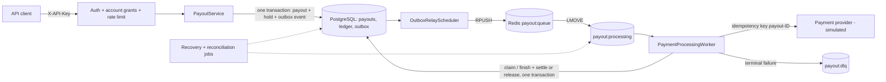
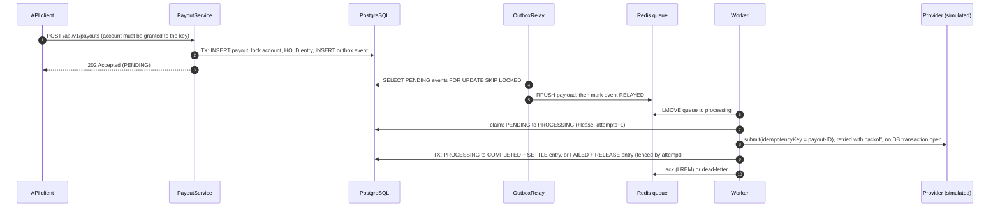

# PaySentinel

[](https://github.com/Vatsasarthak/PaySentinel/actions/workflows/ci.yml)

**Reliable Payout Processing & Ledger Reconciliation**

A Spring Boot payout service that keeps money movement correct when messages are duplicated,
workers crash and the payment provider times out. Built on the transactional outbox pattern, an
append-only PostgreSQL ledger with automated reconciliation, and idempotency at every step.

> **Simulated provider.** Payments go to a built-in simulator. No real money moves and no bank or
> payment network is called.

- Payout, ledger hold and outbox event commit in one PostgreSQL transaction.
- At-least-once Redis queue with leases, fencing tokens and crash recovery.
- Unknown provider outcomes go to manual review with funds held; they are never refunded automatically.
- Dual-approval treasury adjustments and an append-only audit log.
- 146 automated tests against real PostgreSQL and Redis (Testcontainers); GitHub Actions CI workflow.

Java 21 · Spring Boot 3.5 · PostgreSQL 16 · Redis 7 · Flyway · Docker

## Contents

- [Architecture](#architecture)
- [Payout lifecycle](#payout-lifecycle)
- [Ledger](#ledger)
- [Manual review of uncertain payouts](#manual-review-of-uncertain-payouts)
- [Treasury: funding and adjustments](#treasury-funding-and-adjustments)
- [Reliability design](#reliability-design)
- [Technology stack](#technology-stack)
- [Getting started](#getting-started)
- [Troubleshooting](#troubleshooting)
- [Upgrading from the Redis ledger (V3 → V4 → V5)](#upgrading-from-the-redis-ledger-v3--v4--v5)
- [Configuration](#configuration)
- [API](#api)
- [Testing](#testing)
- [Queue recovery and dead-letter behaviour](#queue-recovery-and-dead-letter-behaviour)
- [Security](#security)
- [Performance](#performance)
- [Known limitations](#known-limitations)
- [Roadmap](#roadmap)

A component diagram of the running system is in [`docs/architecture.md`](docs/architecture.md).
Interview notes, a resume entry and the locally verified demo results are in
[`docs/PORTFOLIO.md`](docs/PORTFOLIO.md).

## Architecture



| Package | Responsibility |
| --- | --- |
| `controller/` | Payout API (account-scoped), admin ledger/DLQ/reconciliation, dev-only seeding |
| `service/` | Payouts, PostgreSQL ledger, reconciliation, legacy Redis import, provider calls, recovery |
| `service/gateway/` | Payment-provider contract and the idempotent simulator |
| `queue/` | Reliable Redis list queue (claim, ack, dead-letter, requeue) |
| `security/` | API-key authentication, principals and account grants, Redis rate limiter |
| `scheduler/`, `worker/` | Outbox relay, recovery and reconciliation jobs, queue consumer |
| `config/`, `domain/`, `dto/`, `repository/`, `exception/`, `metrics/` | Configuration, model, persistence, errors, metrics |

The full component diagram (security filter chain, controllers, services, background jobs, and what is
stored in PostgreSQL and Redis) and the startup order are in [`docs/architecture.md`](docs/architecture.md).

## Payout lifecycle



| Status | Meaning |
| --- | --- |
| `PENDING` | Funds held, outbox event written, waiting for a worker |
| `PROCESSING` | Claimed by a worker holding a lease |
| `MANUAL_REVIEW` | Provider outcome unknown after the delivery budget; funds stay **held** until the provider or a treasury operator decides |
| `COMPLETED` | Provider paid; the hold is settled (can never be refunded) |
| `FAILED` | Declined, or the provider confirms it never executed the payment; the hold is released exactly once |
| `REJECTED` | Insufficient balance or unknown account; nothing held |
| `CANCELLED` | Legacy only: a request abandoned mid-way under the old Redis ledger |
| `RESERVING` | Legacy only: no longer produced |

`fundsStatus` is `HELD`, `SETTLED`, `RELEASED` or `NONE`; `RELEASE_PENDING` appears only for refunds
owed by imported legacy payouts and is completed by the recovery job.

## Ledger

Balances live in PostgreSQL:

- `ledger_accounts(account_id, available_balance, held_balance)`, with `CHECK (... >= 0)` on both, so the database refuses an overdraft.
- `ledger_entries` is an append-only journal; a database trigger refuses `UPDATE` and `DELETE`. Each row records `available_delta`, `held_delta`, the resulting balances and a unique `idempotency_key`. Entry types are `OPENING_BALANCE`, `ADJUSTMENT`, `HOLD`, `RELEASE`, `SETTLE`, `CREDIT` and `DEBIT`.
- `audit_events` (also append-only) records who did what for funding adjustments, manual-review decisions and dev seeding.
- Partial unique indexes allow **one `HOLD` per payout** and **one terminal entry (`RELEASE` *or* `SETTLE`) per payout**. A completed payout cannot be refunded, even by a bug.

| Operation | available | held | When |
| --- | --- | --- | --- |
| HOLD | −amount | +amount | Payout accepted (same transaction as the payout and outbox rows) |
| SETTLE | 0 | −amount | Payout completed (same transaction as the status change) |
| RELEASE | +amount | −amount | Payout failed (same transaction as the status change) |
| ADJUSTMENT | ±delta | 0 | Dev seeding |
| CREDIT / DEBIT | ±amount | 0 | Treasury funding adjustment, after approval (debits never touch held funds) |
| OPENING_BALANCE | +balance | 0 | Legacy Redis import |

Every mutation locks the account row (`SELECT … FOR UPDATE`), so concurrent changes to one account are
serialised. Lock order is always payout row, then account row, so the two can't deadlock.

**Reconciliation** (`LedgerReconciliationService`, scheduled every 5 minutes and available at
`GET /api/v1/payouts/ledger/reconciliation`) verifies three things:
1. Each account's balances equal the sum of its entries.
2. Each account's held balance equals its open holds.
3. Each payout's funds status matches its entries.

Findings are logged at ERROR and exported as the `ledger.reconciliation.mismatches` gauge.

**Why the move from Redis.** Under the old design, holding funds (Redis) and recording the payout
(PostgreSQL) could not share a transaction, which required a reservation saga, compensations and
reconciliation retries, and made Redis data loss a money risk. With the ledger in PostgreSQL every
money movement commits atomically with the payout state change that causes it.

## Manual review of uncertain payouts

A payout is never refunded while its payment might still complete. When the provider outcome can't
be established, the payout moves to `MANUAL_REVIEW` (audited, metric `payout.manual_review`) and
its funds stay held:

- **Automatic resolution:** the recovery job re-asks the provider every cycle. A definitive answer settles a COMPLETED payment or refunds a FAILED one, in one transaction with the status change. "Not found" is *not* enough to refund a payout that is already in review.
- **Manual resolution:** a TREASURY key granted the account calls `POST /api/v1/treasury/payout-reviews/{id}/resolution` with `COMPLETED` (requires the provider payment reference) or `FAILED`, plus a mandatory evidence note. A resolution that contradicts a definitive provider answer is refused with 409. Each payout leaves review exactly once.

## Treasury: funding and adjustments

Production balances change only through audited, dual-controlled adjustments. The dev seeding endpoint stays dev-only.

1. A TREASURY key requests a `CREDIT` or `DEBIT` (`POST /api/v1/treasury/adjustments`). The request needs a reason code, an evidence note, an optional external reference and an idempotency key. The balance doesn't change yet.
2. A **different** TREASURY key approves it (`/approve`), which posts the ledger entry, or rejects it (`/reject`). A requester can't approve their own request (403); this is enforced in code and by a database constraint.
3. Posting happens in one transaction with the adjustment row locked, using ledger idempotency key `ADJUSTMENT:<id>`, so concurrent approvals post once. Debits can never take held funds or make a balance negative (422). A credit may open a new account.
4. Every step writes an audit event. `GET /api/v1/payouts/ledger/audit/{ACCOUNT|ADJUSTMENT|PAYOUT}/{id}` (ADMIN) shows the trail.

Separation of duties: ADMIN keys can inspect everything but cannot move money. TREASURY keys can move money only for their granted accounts and cannot create payouts. Treasury is disabled until keys are configured. `payout.funding.require-approval=false` posts immediately and is only for single-operator development; production refuses it.

## Reliability design

- **Atomic money movement.** Creating a payout (row, hold, outbox event) is one transaction. Finishing a payout (status, settle or release) is one transaction. Ledger operations require an enclosing transaction (`Propagation.MANDATORY`).
- **Duplicate and concurrent processing.** Workers claim payouts with a conditional `UPDATE` plus a lease. Outcomes are written only by the current claim holder, using the attempt number as a fencing token. Holds, releases and settlements are idempotent per payout and enforced by unique indexes.
- **Provider idempotency.** Every provider call for a payout uses the idempotency key `payout-<payoutId>`, including backoff retries, redeliveries after a crash and other workers. A provider must return the original result for a repeated key; the simulator does, and also refuses a concurrent request with the same key. After the last timeout the worker **looks up** the key before giving up:
  - If the provider has a result, that result stands.
  - If the provider confirms it never executed the request, the payout is failed and refunded.
  - If a request is still in flight or the provider can't be asked, the payout is redelivered later, and after `max-delivery-attempts` it moves to `MANUAL_REVIEW` **with its funds still held**. The same check runs when a payout's delivery budget is spent for any other reason (e.g. repeated worker crashes), so a payout the provider paid is completed, never refunded.
- **Idempotent API.** Idempotency keys are unique per API client. Identical retries return the original payout. A different payload with the same key returns `409`. Concurrent duplicates are resolved by the unique constraint.
- **Delivery semantics.** Outbox to queue is at-least-once, and the queue redelivers abandoned messages. Exactly-once *effects* come from the database claim/fencing, the ledger constraints and provider idempotency, not from Redis.

## Technology stack

Java 21 · Spring Boot 3.5 (Web, Validation, Security, Data JPA, JDBC, Data Redis, Actuator) · Spring
Retry · ShedLock (Redis provider) · Flyway · PostgreSQL 16 · Redis 7 · Micrometer · JUnit 5, Mockito,
Testcontainers · Docker · GitHub Actions.

## Getting started

### Prerequisites

- Java 21
- Docker Desktop (or Docker Engine with Compose v2)
- Maven 3.9+ is optional; the Maven Wrapper (`mvnw` / `mvnw.cmd`) is included

### 1. Configure environment variables

```bash
cp .env.example .env        # Windows PowerShell: Copy-Item .env.example .env
```

Edit `.env` and replace every placeholder. In particular:

- `APP_CLIENT_API_KEY` and `APP_ADMIN_API_KEY`: at least 32 random characters each. Generate them with `openssl rand -hex 32`, or in PowerShell: `$b = New-Object byte[] 32; [Security.Cryptography.RandomNumberGenerator]::Create().GetBytes($b); -join ($b | ForEach-Object { $_.ToString('x2') })`. You may set `*_API_KEY_SHA256` (the key's hex SHA-256) instead, so the server never holds the plain key.
- `APP_CLIENT_ACCOUNTS`: the comma-separated ledger accounts the client key may use, e.g. `user_123`.
  This only *authorizes* the key; it does not create the ledger account (see step 4).
- `APP_ENVIRONMENT=local`: required for any development-only feature (the `dev` profile, seeding, the
  `loggers` endpoint). If it is unset or has any other value, the application refuses to start with them.

The application refuses to start if a key is missing, short, a placeholder or reused.

> If you previously ran this project with the original `docker-compose.yml`, the existing PostgreSQL
> volume was initialised with the password `payment_pass`. Set `POSTGRES_PASSWORD=payment_pass` in
> `.env`: PostgreSQL keeps the password a volume was created with, and editing `.env` does not change
> it. Do not delete the volume to fix a password mismatch; that permanently deletes all local data.

### 2. Start PostgreSQL and Redis

```bash
docker compose up -d
```

Both bind to `127.0.0.1` only. If ports 5432/6379 are taken, set `POSTGRES_HOST_PORT`,
`REDIS_HOST_PORT`, `DB_URL` and `REDIS_PORT` in `.env`.

### 3. Run the application

```bash
./mvnw spring-boot:run -Dspring-boot.run.profiles=dev      # macOS/Linux
mvnw.cmd spring-boot:run "-Dspring-boot.run.profiles=dev"  # Windows
```

The application reads `.env` from the working directory. The `dev` profile enables ledger seeding
and the `loggers` actuator endpoint; omit it everywhere else.

To run everything in containers instead, set `SPRING_PROFILES_ACTIVE=dev` and `APP_ENVIRONMENT=local`
in `.env` (otherwise the seeding endpoint is not registered and step 4 fails), then:

```bash
docker compose --profile app up -d --build
```

Variables exported in your shell take precedence over `.env` when docker compose starts the stack.

### 4. Try it

A fresh database has **no ledger accounts**: `GET /api/v1/payouts/ledger/balance/user_123` with the
**ADMIN** key returns 404 with `type` ending in `account-not-found` (a missing *route* returns `about:blank` / "No static
resource" instead). In local development the account is created by the seeding endpoint, which **sets**
(overwrites) the available balance and records a ledger entry and an audit event. Elsewhere, accounts are
funded through dual-approved treasury adjustments. Every `/api/v1/payouts/ledger/**` endpoint is
ADMIN-only: called with the CLIENT key it returns `403 Forbidden`, which is expected (see [API](#api)).

Amounts are whole **paise** (see [Amounts](#amounts)): the examples below seed 100000 = ₹1,000.00 and
pay out 5000 = ₹50.00.

macOS/Linux:

```bash
ADMIN=<APP_ADMIN_API_KEY>; CLIENT=<APP_CLIENT_API_KEY>
curl -X POST "http://localhost:8080/api/v1/payouts/ledger/seed?accountId=user_123&amount=100000" -H "X-API-Key: $ADMIN"
curl -X POST http://localhost:8080/api/v1/payouts -H "X-API-Key: $CLIENT" -H "Content-Type: application/json" \
     -d '{"recipientId":"user_123","amount":5000,"currency":"INR","idempotencyKey":"payout-req-001"}'
curl http://localhost:8080/api/v1/payouts/<id> -H "X-API-Key: $CLIENT"
```

Windows PowerShell (reads the keys from `.env` into variables without printing them):

```powershell
$cfg = @{}
Get-Content .env | Where-Object { $_ -match '^\s*[A-Za-z_][A-Za-z0-9_]*\s*=' } |
    ForEach-Object { $k, $v = $_ -split '=', 2; $cfg[$k.Trim()] = $v.Trim() }
$admin  = @{ 'X-API-Key' = $cfg['APP_ADMIN_API_KEY'] }
$client = @{ 'X-API-Key' = $cfg['APP_CLIENT_API_KEY'] }
Invoke-RestMethod -Method Post 'http://localhost:8080/api/v1/payouts/ledger/seed?accountId=user_123&amount=100000' -Headers $admin
$payout = Invoke-RestMethod -Method Post 'http://localhost:8080/api/v1/payouts' -Headers $client -ContentType 'application/json' `
    -Body '{"recipientId":"user_123","amount":5000,"currency":"INR","idempotencyKey":"payout-req-001"}'
Invoke-RestMethod "http://localhost:8080/api/v1/payouts/$($payout.id)" -Headers $client
```

### 5. Poll the payout until it is final

Processing is asynchronous: `POST` returns `202` with status `PENDING`, and the outbox relay and worker
move it to `COMPLETED` (funds `SETTLED`) or `FAILED` (funds `RELEASED`). Poll the read endpoint; never
resubmit with a new idempotency key to "retry". Re-sending the **same** request with the **same** key is
safe and returns the same payout.

```powershell
# Continues the PowerShell session above ($client and $payout already set).
$deadline = (Get-Date).AddMinutes(3)
do {
    Start-Sleep -Seconds 2
    $p = Invoke-RestMethod "http://localhost:8080/api/v1/payouts/$($payout.id)" -Headers $client
    "{0}  status={1} funds={2}" -f (Get-Date -Format T), $p.status, $p.fundsStatus
} until ($p.status -in 'COMPLETED', 'FAILED', 'MANUAL_REVIEW' -or (Get-Date) -gt $deadline)
```

`MANUAL_REVIEW` means the simulated provider's outcome could not be established; the funds stay held
(see [Manual review](#manual-review-of-uncertain-payouts)). Then check the balance and the ledger:

```powershell
Invoke-RestMethod 'http://localhost:8080/api/v1/payouts/ledger/accounts/user_123' -Headers $admin
Invoke-RestMethod 'http://localhost:8080/api/v1/payouts/ledger/reconciliation' -Headers $admin
```

### 6. Health check and tests

```powershell
Invoke-RestMethod http://localhost:8080/actuator/health   # {"status":"UP"}
.\mvnw.cmd clean verify                                     # needs Docker running (Testcontainers)
docker compose config --quiet; docker compose --profile app config --quiet
```

The tests use their own throwaway PostgreSQL and Redis containers; they never touch your local data.

### 7. Rebuild or stop without losing data

```powershell
# Rebuild and restart only the application; PostgreSQL and Redis keep running untouched.
docker compose --profile app build app
docker compose --profile app up -d --no-deps --force-recreate app

docker compose --profile app stop    # stop the containers, keep them and all data
docker compose --profile app down    # remove the containers; the data volumes are kept
```

> **Destructive: never add `-v`** (`docker compose down -v`). It removes the PostgreSQL and Redis
> volumes and permanently deletes every local payout, balance, ledger entry and queued message. Use
> `stop` or `down` (without `-v`) for routine work; if you really want an empty database, back it up
> first (`pg_dump`) and make sure nothing in it is needed.

### Database migrations

Flyway runs automatically at startup (`src/main/resources/db/migration`):

| Version | Change |
| --- | --- |
| V1 | `payouts` table |
| V2 | `outbox_events` table |
| V3 | `TIMESTAMPTZ` timestamps (existing values interpreted as Asia/Kolkata), `funds_status`, `lease_until`, `failure_reason`, check constraints, indexes |
| V4 | `ledger_accounts` and `ledger_entries` (with non-negative balance checks and per-payout unique hold/terminal indexes); `payouts.client_id` and `payouts.provider_reference`; the global idempotency-key uniqueness is replaced by uniqueness per `(client_id, idempotency_key)` |
| V5 | `MANUAL_REVIEW` status; `ledger_adjustments` (dual-control constraint) and `audit_events`; `CREDIT`/`DEBIT` entry types; triggers making `ledger_entries` and `audit_events` append-only |

`spring.jpa.hibernate.ddl-auto=validate` makes startup fail if entities and schema drift apart.

## Troubleshooting

| Symptom | Cause and fix |
| --- | --- |
| `docker compose up` fails with "port is already allocated" | Another PostgreSQL/Redis uses 5432/6379. Set `POSTGRES_HOST_PORT`/`REDIS_HOST_PORT` (and `DB_URL`/`REDIS_PORT` for a host-run app) in `.env`. |
| Compose: "required variable POSTGRES_PASSWORD is missing" | `.env` is missing or not in the project directory. Copy `.env.example` to `.env` and fill it in. |
| App exits: "Development-only features require APP_ENVIRONMENT=local" | The `dev` profile, seeding or the `loggers` endpoint is on without `APP_ENVIRONMENT=local`. Set it in `.env` (local machines only). |
| App exits: "Unsafe configuration for production" | `APP_ENVIRONMENT=production` with a development or safety-reducing setting; remove that setting. |
| App exits: "API key ... must be at least 32 characters", "placeholder", "set exactly one of api-key or api-key-sha256", "Every API key must be different" | Fix the keys in `.env`; generate new ones as described in step 1. |
| App exits: "Legacy Redis ledger data has not been imported" | Pre-V4 Redis balances could not be imported. See [Upgrading](#upgrading-from-the-redis-ledger-v3--v4--v5); do not delete Redis data. |
| PostgreSQL "password authentication failed" after editing `.env` | The volume keeps the password it was created with. Put the original `POSTGRES_PASSWORD` back; changing it requires `ALTER USER` inside PostgreSQL, not deleting the volume. |
| Redis `NOAUTH` / "invalid password" | The Redis container was started with a different `REDIS_PASSWORD`. Restore the original value, or recreate only the Redis container (`docker compose up -d --force-recreate redis`; the volume and data are kept). |
| Flyway: "Validate failed: Migration checksum mismatch" | An already-applied migration file under `db/migration` was edited. Restore its original content and add a new `V6__...` migration instead; never edit applied migrations or delete rows from `flyway_schema_history`. |
| `401 Unauthorized` | Missing or wrong `X-API-Key`. Keys are read when the app starts: restart a host-run app, or recreate the app container (step 7) after changing `.env`. |
| `403 Forbidden` (`type` ending `forbidden`) on `/api/v1/payouts/ledger/**` or `/api/v1/payouts/dlq` | Expected with a CLIENT key: these endpoints are ADMIN-only. Use the ADMIN key. In Windows PowerShell the response body is in `$_.ErrorDetails.Message` (see [API examples](#examples-powershell)). |
| `403 account-access-denied` | The key is not granted that account (`APP_CLIENT_ACCOUNTS`). The admin key cannot create payouts unless `APP_ADMIN_ACCOUNTS` grants it. |
| `404` on the ledger balance with `type` ending `account-not-found` | The route exists but the account does not: seed it (dev) or fund it via treasury. |
| `404 "No static resource ...ledger/seed"` | The seeding route is not registered: the `dev` profile is not active (step 3). |
| `422 insufficient-balance` | The account has no ledger row yet or too little available balance (held funds are not spendable). |
| `400 Malformed Request` for an amount | Amounts are whole paise; `50.75` is rejected. Send `5075` for ₹50.75. |
| `429 Too Many Requests` | Rate limit hit; wait for `Retry-After` seconds. |
| Tests fail with "Could not find a valid Docker environment" | Start Docker Desktop; the integration tests use Testcontainers. |
| PostgreSQL error `invalid value for parameter "TimeZone": "Asia/Calcutta"` from a custom launcher | Recent PostgreSQL images reject that legacy zone name. The app and tests force UTC; for other JVM tools pass `-Duser.timezone=UTC`. |

## Upgrading from the Redis ledger (V3 → V4 → V5)

V5 is additive: a `MANUAL_REVIEW` status, the `ledger_adjustments` and `audit_events` tables, `CREDIT`/`DEBIT` entry types, and append-only triggers. It needs no data migration and can be applied after V4 or together with it.

V4 deletes no data. It is **not** compatible with running old and new versions side by side.

1. **Stop every old instance.** They write balances to Redis and rely on the old global idempotency constraint, so a rolling upgrade is unsafe.
2. **Back up PostgreSQL and Redis** (`pg_dump`, plus the Redis AOF/RDB files).
3. **Start the new version.** Flyway applies V4. Then `RedisLedgerImporter` runs before the HTTP server and scheduled jobs start. For every legacy account, it:
   - creates the PostgreSQL account with an `OPENING_BALANCE` equal to the Redis balance plus the funds still held for in-flight payouts;
   - adds one `HOLD` entry per such payout;
   - normalises each payout's funds status. Hold markers decide whether a `RELEASE_PENDING` or abandoned `RESERVING` payout is still owed its refund.

   Imported Redis keys are **renamed** to `ledger-migrated:<accountId>`, not deleted; hold markers are left untouched. The import is idempotent and safe if several instances start at once. An account that already exists in PostgreSQL is never overwritten; it is reported as a conflict for manual review.
4. **Verify.** `GET /api/v1/payouts/ledger/reconciliation` must report `consistent: true`. Owed refunds complete within one recovery cycle (30 s).
   If legacy data cannot be imported, for example because an account already exists in PostgreSQL, **the application refuses to start** (`payout.ledger.fail-on-unmigrated-legacy-data=true`). It also refuses if the import is disabled while legacy data remains. Payouts whose funds were held in Redis can't be settled or refunded safely until an operator resolves this. Each account imports in one transaction, so an interrupted import resumes cleanly on restart.
5. **Afterwards**, keep or archive the `ledger-migrated:*` and `ledger:hold:*` keys, and optionally set `LEDGER_REDIS_IMPORT_ENABLED=false`.

Also note:
- Existing payouts are attributed to the client `legacy`, a reserved name. Payouts are readable by any key granted their account.
- Responses gain `providerReference`.
- All payout calls now need an API key granted the account.

**Rollback** after new payouts exist requires copying balances back to Redis. Prefer restoring the backups.

**Latest rehearsal (V3 → V4 → V5, throwaway containers):**
1. The original version took 400 payouts and was hard-killed.
2. PostgreSQL and Redis were backed up; the PostgreSQL backup was later restored and checked.
3. The V4 version imported the account and was hard-killed mid-processing, then backed up again.
4. A production-flagged start with dev settings was refused before migrating.
5. V5 migrated, finished every payout, and posted a dual-approved credit.

Result: the balance equalled seed + credits − completed payouts, and reconciliation was consistent.

An earlier rehearsal of the V3 → V4 step alone:
1. The previous version took 800 payouts and was hard-killed mid-processing, leaving 615 payouts in flight and 61,500 held.
2. The new version imported the account (available 924,600, held 61,500), finished every payout, and reconciled exactly.
3. The final balance equalled the seed minus every completed payout across both versions.

## Configuration

Environment variables (see `.env.example`):

| Variable | Purpose | Default |
| --- | --- | --- |
| `DB_URL`, `DB_USERNAME`, `DB_PASSWORD`, `DB_POOL_SIZE` | Database connection | `localhost:5432/payment_db`, `payment_user`, required, `20` |
| `REDIS_HOST`, `REDIS_PORT`, `REDIS_PASSWORD` | Redis connection | `localhost`, `6379`, none |
| `APP_CLIENT_NAME`, `APP_CLIENT_API_KEY` or `APP_CLIENT_API_KEY_SHA256`, `APP_CLIENT_ACCOUNTS` | The API client and its granted accounts | `default-client`, required, none |
| `APP_ADMIN_API_KEY` or `APP_ADMIN_API_KEY_SHA256`, `APP_ADMIN_ACCOUNTS`, `APP_ADMIN_READ_ALL_PAYOUTS` | Admin key, optional payout grants, explicit read-all opt-in | required, none, `false` |
| `APP_TREASURY_{1,2}_NAME`, `_API_KEY` or `_API_KEY_SHA256`, `_ACCOUNTS`, `_ALL_ACCOUNTS` | Treasury keys and their accounts (none = treasury disabled) | none |
| `APP_ENVIRONMENT` | `local` permits dev-only features; `production` refuses them and every safety-reducing setting; unset or other values refuse dev-only features (checked before migrations) | unset |
| `LEDGER_REDIS_IMPORT_ENABLED` | Legacy Redis ledger import at startup | `true` |
| `POSTGRES_HOST_PORT`, `REDIS_HOST_PORT`, `APP_HOST_PORT` | Host ports for docker compose | `5432`, `6379`, `8080` |

In container mode (`docker compose --profile app`), `docker-compose.yml` forwards the variables above to
the application, with the same safe defaults. The exceptions are the database and Redis connection
settings, which compose points at its own `postgres` and `redis` services.

**Several API clients.** Environment variables configure one client. For more, put the whole list in
an extra config file and point `SPRING_CONFIG_ADDITIONAL_LOCATION` at it. Spring replaces lists
rather than merging them across sources. The compose file does not mount such a file into the
container, so this applies to a host-run application unless you add a volume for it.

```yaml
payout:
  security:
    clients:
      - name: merchant-a
        api-key-sha256: 3f1c…          # hex SHA-256 of the key
        accounts: [merchant_a_main, merchant_a_eu]
      - name: merchant-b
        api-key-sha256: 9ab0…
        accounts: [merchant_b_main]
```

Application settings (`application.yaml`, prefix `payout.`):

| Property | Default | Meaning |
| --- | --- | --- |
| `supported-currencies` | `INR` | Accepted ISO 4217 codes (the ledger has no currency dimension) |
| `rate-limit.enabled` / `fail-open` | `true` / `true` | Rate limiting; behaviour when Redis is unreachable (`false` → 503) |
| `rate-limit.create` | 50 burst, 20/s | `POST /api/v1/payouts` per client |
| `rate-limit.read` | 200 burst, 100/s | Payout reads per client |
| `rate-limit.admin` | 30 burst, 10/s | Ledger/DLQ/treasury/protected actuator per key |
| `rate-limit.auth-failure` | 20 burst, 1/s | Invalid API keys per client IP |
| `relay.interval-ms` / `batch-size` / `lock-at-most-for` | `1000` / `100` / `PT1M` | Outbox relay |
| `worker.poll-interval-ms` / `concurrency` / `batch-size` | `200` / `16` / `20` | Queue consumer |
| `worker.lease-duration` / `max-delivery-attempts` | `PT60S` / `5` | Claim lease and delivery budget |
| `queue.visibility-timeout` | `PT2M` | Age after which an in-flight message is re-queued (must exceed the lease) |
| `recovery.interval-ms` / `reconciliation-interval-ms` / `stuck-payout-timeout` | `30000` / `300000` / `PT10M` | Recovery and reconciliation jobs |
| `gateway.success-percent` / `failure-percent` / `processed-before-timeout-percent` | `70` / `20` / `50` | Simulator outcome mix (remaining 10 % time out; half of those after paying) |
| `gateway.max-attempts` / `backoff-delay-ms` / `backoff-multiplier` | `3` / `2000` / `2` | Provider retry policy |
| `ledger.seed-enabled` | `false` | Enables the seeding endpoint (`true` in `dev`) |
| `ledger.fail-on-unmigrated-legacy-data` | `true` | Refuse to start while legacy Redis ledger data is unimported |
| `funding.require-approval` | `true` | Dual control for funding adjustments |

## API

All endpoints except `/actuator/health` and `/actuator/info` require an `X-API-Key` header. The full
specification is in [`docs/openapi.yaml`](docs/openapi.yaml).

> **ADMIN-only endpoints.** Every `/api/v1/payouts/ledger/**` endpoint (balance, account, reconciliation,
> audit, seeding) and `/api/v1/payouts/dlq` require the ADMIN key. A CLIENT key receives
> `403 Forbidden` with a problem-details body whose `type` ends in `forbidden`. This is expected
> behaviour, not a key problem (an unknown key gets `401`). Clients read their payouts with
> `GET /api/v1/payouts/{id}`; balances and reconciliation are operator views.

| Method | Path | Who | Description |
| --- | --- | --- | --- |
| `POST` | `/api/v1/payouts` | CLIENT (or ADMIN) key granted the `recipientId` account | Initiate a payout. `202 Accepted` |
| `GET` | `/api/v1/payouts/{id}` | CLIENT or ADMIN key granted the payout's account (ADMIN: accounts in `APP_ADMIN_ACCOUNTS`, or all with read-all) | Fetch a payout |
| `POST` | `/api/v1/payouts/ledger/seed?accountId=&amount=` | ADMIN, `dev` only | Set an account's available balance |
| `GET` | `/api/v1/payouts/ledger/balance/{accountId}` | ADMIN | Available balance |
| `GET` | `/api/v1/payouts/ledger/accounts/{accountId}` | ADMIN | Available and held balance, last 50 ledger entries |
| `GET` | `/api/v1/payouts/ledger/reconciliation` | ADMIN | Ledger consistency report |
| `GET` | `/api/v1/payouts/dlq` | ADMIN | Dead-lettered messages |
| `GET` | `/api/v1/payouts/ledger/audit/{type}/{id}` | ADMIN | Audit trail of an `ACCOUNT`, `ADJUSTMENT` or `PAYOUT` |
| `POST` | `/api/v1/treasury/adjustments` | TREASURY (account granted) | Request a credit or debit. `201`, or `200` for an identical retry |
| `GET` | `/api/v1/treasury/adjustments/{id}` | TREASURY | Adjustment status |
| `POST` | `/api/v1/treasury/adjustments/{id}/approve` or `/reject` | A *different* TREASURY key | Post or reject; body `{"note": "..."}` |
| `GET` | `/api/v1/treasury/payout-reviews` | TREASURY | Payouts in manual review on granted accounts |
| `POST` | `/api/v1/treasury/payout-reviews/{id}/resolution` | TREASURY | `{"resolution":"COMPLETED","providerReference":"...","note":"..."}` or `FAILED` |
| `GET` | `/actuator/health`, `/actuator/info` | public | Health (component details for ADMIN); configured app name, description and version |
| `GET` | `/actuator/metrics/**` | ADMIN | Metrics |

### Examples (PowerShell)

These examples work in Windows PowerShell 5.1 and PowerShell 7. They read the two keys from `.env` into
environment variables of the current PowerShell session, so no key is typed, hard-coded or printed.

```powershell
# Run from the project directory. The variables last only for this PowerShell session.
Get-Content .env | Where-Object { $_ -match '^\s*(APP_CLIENT_API_KEY|APP_ADMIN_API_KEY)\s*=' } |
    ForEach-Object { $name, $value = $_ -split '=', 2; Set-Item -Path "Env:$($name.Trim())" -Value $value.Trim() }
$base = 'http://localhost:8080'
```

**1. Create a payout (CLIENT key).** `recipientId` must be an account granted to the CLIENT key
(`APP_CLIENT_ACCOUNTS`) and must have enough available balance. This holds 5000 paise (₹50.00) in your
local ledger and sends the payment to the simulator.

```powershell
$request = @{
    recipientId    = 'user_123'          # account granted to the CLIENT key
    amount         = 5000                # whole paise: 5000 = INR 50.00
    currency       = 'INR'
    idempotencyKey = 'demo-payout-0001'  # resend the same request to retry safely; use a new key for a new payout
} | ConvertTo-Json
$payout = Invoke-RestMethod -Method Post "$base/api/v1/payouts" -ContentType 'application/json' `
    -Headers @{ 'X-API-Key' = $env:APP_CLIENT_API_KEY } -Body $request
$payout | Select-Object id, status, fundsStatus   # 202 Accepted: PENDING / HELD
```

Re-sending the same request with the same key returns the same payout. The same key with a different
payload returns `409 Conflict` (`idempotency-key-reused`).

**2. Retrieve the payout by its ID (CLIENT key).** Processing is asynchronous; repeat until `status` is
`COMPLETED`, `FAILED` or `MANUAL_REVIEW`.

```powershell
Invoke-RestMethod "$base/api/v1/payouts/$($payout.id)" -Headers @{ 'X-API-Key' = $env:APP_CLIENT_API_KEY } |
    Select-Object id, status, fundsStatus, attempts, failureReason
```

A payout on an account the key is not granted returns `404`, so its existence is not revealed.

**3. Run ledger reconciliation (ADMIN key).** Read-only: it checks balances against the journal and
changes nothing.

```powershell
Invoke-RestMethod "$base/api/v1/payouts/ledger/reconciliation" -Headers @{ 'X-API-Key' = $env:APP_ADMIN_API_KEY }
# consistent = True and mismatchCount = 0 when the ledger agrees with its journal
```

The same call with the CLIENT key returns `403 Forbidden`, as expected for an ADMIN-only endpoint.
PowerShell reports the error instead of printing the body; read the body like this:

```powershell
try { Invoke-RestMethod "$base/api/v1/payouts/ledger/reconciliation" -Headers @{ 'X-API-Key' = $env:APP_CLIENT_API_KEY } }
catch { $_.ErrorDetails.Message }   # {"type":"...forbidden","title":"Forbidden","status":403,...}
```

When you are done, remove the keys from the session:
`Remove-Item Env:APP_CLIENT_API_KEY, Env:APP_ADMIN_API_KEY`.

### Amounts

Every amount and balance (payouts, ledger balances and entries, adjustments, seeding) is a **whole number
of the currency's minor unit**. For INR that is **paise**: `5000` means ₹50.00 and `100000` means ₹1,000.00.
This is a convention of this application. The payment provider is simulated, so nothing is converted,
settled or sent to a real payment network.

- Fractional values are rejected with 400 (`Malformed Request`), never rounded or truncated. This covers
  `50.75`, `0.99`, and also integral floating-point forms such as `5000.0` and `5e3`. To send ₹50.75, send `5075`.
- A whole number sent as a JSON string (`"5000"`) is accepted, as before.
- The largest single amount is 1,000,000,000,000 paise (₹10,000,000,000.00).

Request:

```json
{ "recipientId": "user_123", "amount": 5000, "currency": "INR", "idempotencyKey": "payout-req-001" }
```

Validation:
- `recipientId`: 1–64 characters from `[A-Za-z0-9_-]`.
- `amount`: whole paise from 1 to 1,000,000,000,000; fractional numbers are rejected.
- `currency`: 3 uppercase letters, and one of `supported-currencies`.
- `idempotencyKey`: 8–128 characters from `[A-Za-z0-9._:-]`, unique per API client.

Response (`202`), with timestamps as UTC instants:

```json
{
  "id": "f2f6a4d7-8d7a-4d62-8d1f-3b2b7b0a1a7c",
  "recipientId": "user_123",
  "amount": 5000,
  "currency": "INR",
  "status": "PENDING",
  "fundsStatus": "HELD",
  "failureReason": null,
  "providerReference": null,
  "createdAt": "2026-07-04T04:30:00.123456Z",
  "updatedAt": "2026-07-04T04:30:00.131002Z",
  "attempts": 0
}
```

Errors are RFC 7807 problem details. The application's own errors have a `type` of the form
`urn:paysentinel:errors:<slug>`, for example `urn:paysentinel:errors:idempotency-key-reused`; match on
the full value or on the slug. Errors produced by Spring itself, such as an unknown route, use
`about:blank`.

| Status | When |
| --- | --- |
| `400` | Validation failure (with an `errors` map), malformed JSON/UUID/parameter (including a fractional amount), unsupported currency |
| `401` | Missing or invalid API key |
| `403` | Role not allowed (`forbidden`), key not granted the account (`account-access-denied`), or self-approval of an adjustment (`four-eyes-required`) |
| `404` | Unknown route or account, or a payout that doesn't exist **or belongs to an account the key isn't granted** (existence isn't revealed) |
| `405` | Unsupported HTTP method |
| `409` | `idempotency-key-reused` (same key, different payload), or `state-conflict` (adjustment already decided, payout not in review, resolution contradicting the provider) |
| `422` | Insufficient balance or unknown recipient account (replays of the same key return 422 again) |
| `429` | `rate-limited`, with `Retry-After` |
| `503` | `rate-limiter-unavailable` (only when `rate-limit.fail-open=false`) |
| `500` | Unexpected error (no internal details are returned) |

## Testing

```bash
./mvnw verify          # macOS/Linux
mvnw.cmd verify        # Windows
```

Docker must be running: integration tests start PostgreSQL 16 and Redis 7 with Testcontainers.
The default build runs **146 tests**. That count includes three runs of
`SchedulerShutdownIntegrationTest`; pass `-Dpayout.shutdown-test.runs=N` to repeat it N times.

Background scheduling is disabled in the `test` profile, so most tests drive the relay, worker and
recovery jobs explicitly. `SchedulingIntegrationTest` and `SchedulerShutdownIntegrationTest`
deliberately enable the real schedulers. Tests built on `BaseIntegrationTest` stub the simulated
provider's outcome with Mockito, use an injectable clock to simulate timeouts, and reset state before
and after every test.

| Test class | Covers |
| --- | --- |
| `OutboxApplicationTests` | Context start, all five migrations, Redis/PostgreSQL wired to the containers |
| `PayoutLifecycleApiIntegrationTest` | The documented API flow end to end (create, replay, conflict, relay, worker, poll, balance, reconciliation, replay after completion) for a completed and a declined payout |
| `AmountFormatIntegrationTest` | Fractional amounts (`50.75`, `0.99`, `5000.0`, `5e3`, `"50.75"`) rejected with 400 and nothing created; integer amounts and unrelated JSON parsing unchanged |
| `JacksonConfigurationTest` | The only difference from Spring Boot's Jackson defaults is `ACCEPT_FLOAT_AS_INT` disabled |
| `SchedulingIntegrationTest` | All four jobs registered; a payout processed end to end by the real schedulers |
| `SchedulerShutdownIntegrationTest` | Application shutdown while the scheduled outbox relay is mid-publish (holding its ShedLock lock): Redis stays up until the relay finishes, the event is published once and marked `RELAYED`, the lock is released, and no `LockException` is logged. Each run starts and closes its own application context (3 runs by default) |
| `ProblemTypesTest` | Error `type` URIs are `urn:paysentinel:errors:<slug>`; malformed slugs are rejected |
| `SecurityConfigTest` | Key validation (length, placeholders, duplicates, reserved names, SHA-256 keys), explicit account grants |
| `PayoutApiSecurityIntegrationTest` | 401/403, cross-account create (403) and read (404), shared accounts, per-client idempotency, admin not bypassing ownership, actuator exposure |
| `RateLimitIntegrationTest` | Per-client create limit with refill, separate read bucket, admin limit, invalid-key throttling per IP, fail-open and fail-closed |
| `PayoutApiErrorHandlingIntegrationTest` | 400/404/405/409/422/500 responses without internal details |
| `LedgerServiceIntegrationTest` | Idempotent hold, refund exactly once, settle/release exclusivity (including the DB constraint), 25 concurrent holds never overdraw, 10 concurrent releases refund once, mixed concurrent operations reconcile, tamper detection |
| `PayoutServiceIntegrationTest` | Atomic creation, idempotent replay, key reuse conflict, per-client keys, insufficient balance, concurrent same-key requests, DB failure rolls back payout + hold + outbox together |
| `OutboxRelaySchedulerIntegrationTest` | Publishing, no double publish, retry after Redis failure, bounded batches |
| `PaymentProcessingWorkerIntegrationTest` | Success, failure with exactly-once refund, duplicate after completion, concurrent delivery, crash recovery, DLQ, delivery budget, malformed messages |
| `GatewayIdempotencyIntegrationTest` | Same key on every retry, lost response not paid twice, crash redelivery not paid twice, duplicate submits, in-flight request neither failed nor refunded |
| `PayoutRecoveryServiceIntegrationTest` | Owed refunds completed once, lost messages re-published |
| `UncertainProviderOutcomeIntegrationTest` | In-flight or unreachable provider leads to manual review with funds held (no refund); exhausted payouts the provider paid are completed; automatic resolution only on definitive answers |
| `TreasuryIntegrationTest` | Role separation, dual control, idempotent and concurrent requests, concurrent approvals post once, held funds never debited, validation, append-only triggers, manual-review resolution with provider cross-check |
| `ProductionSafetyCheckTest` | Dev-only features start only with `APP_ENVIRONMENT=local`/`test`; production refuses them and every safety-reducing setting |
| `RedisLedgerImporterIntegrationTest` | Legacy import of every funds state, no money lost, idempotent re-run, conflicts not overwritten, crash before rename |

CI (`.github/workflows/ci.yml`) runs `./mvnw verify` and builds the Docker image on every push to
`main` and every pull request. It needs no repository secrets.

## Queue recovery and dead-letter behaviour

| Redis key | Purpose |
| --- | --- |
| `payout:queue` | Messages waiting for a worker |
| `payout:processing` / `payout:processing:claims` | Claimed messages and their claim timestamps |
| `payout:dlq` / `payout:dlq:ids` | Dead-lettered payloads, de-duplicated by payout ID |
| `ratelimit:*` | Token buckets |
| `gateway:sim:payment:*` | The simulator's idempotency store (stands in for the provider's storage) |
| `ledger-migrated:*`, `ledger:hold:*` | Preserved legacy Redis ledger data (read-only after import) |

The recovery job runs every 30 s on one instance at a time (ShedLock). Each run:
1. Re-queues messages abandoned in `payout:processing`.
2. Completes owed refunds.
3. Re-asks the provider about payouts in `MANUAL_REVIEW`; only a definitive answer (completed or
   failed) resolves them.
4. Re-publishes payouts that have been idle too long and whose message was lost.

Reconciliation runs every 5 minutes.

How a delivery ends depends on what the provider reports. Each delivery makes up to
`gateway.max-attempts` provider calls with the same idempotency key; after the last timeout the worker
looks the key up:

| Provider outcome | Payout | Funds | Queue message |
| --- | --- | --- | --- |
| Completed (answered directly, or found by the lookup) | `COMPLETED` | settled | acknowledged |
| Declined (answered directly, or found by the lookup) | `FAILED` (`DECLINED`) | released | acknowledged |
| Every call timed out and the provider never executed the request (not found) | `FAILED` (`RETRIES_EXHAUSTED`) | released | dead-lettered |
| Unknown (still in flight or provider unreachable), delivery attempts left | unchanged | held | not acknowledged; redelivered after the lease and visibility timeout expire |
| Unknown on the last delivery attempt | `MANUAL_REVIEW` (`PROVIDER_OUTCOME_UNKNOWN`) | held | acknowledged |

A payout's delivery budget is `max-delivery-attempts` claims. When a message arrives for a payout
whose budget is already spent, the worker asks the provider before deciding:

| Provider reports | Payout | Funds | Queue message |
| --- | --- | --- | --- |
| Completed | `COMPLETED` | settled | acknowledged |
| Declined | `FAILED` (`DECLINED`) | released | dead-lettered |
| Never executed (not found) | `FAILED` (`MAX_DELIVERY_ATTEMPTS`) | released | dead-lettered |
| Still in flight or unreachable | `MANUAL_REVIEW` (`PROVIDER_OUTCOME_UNKNOWN`) | held | acknowledged |

A malformed message, or one that references an unknown payout, is dead-lettered without changing any
payout. A message for a payout that is already final, or currently claimed by another worker, is a
duplicate and is acknowledged without changing the payout; if a crash interrupted dead-lettering a
failed payout, the duplicate completes it (dead-letter entries are de-duplicated by payout ID).
Payouts in `MANUAL_REVIEW` keep their funds held until the recovery job gets a definitive provider
answer or a treasury operator resolves them (see [Manual review](#manual-review-of-uncertain-payouts));
they are never refunded automatically.

## Security

- **Authentication:** API keys in the `X-API-Key` header, compared as SHA-256 digests in constant time. Keys can be configured as digests. The service is stateless: no sessions, no cookies, CSRF off.
- **Authorization by account:** each CLIENT key has an explicit list of granted ledger accounts. It can only create payouts for, and read payouts of, those accounts. Payouts on other accounts return 404.
- **ADMIN is an operations role:**
  - It can use ledger, DLQ, reconciliation and protected actuator endpoints, and see balances of any account (documented, for support).
  - It can create payouts only for accounts in `APP_ADMIN_ACCOUNTS` (none by default).
  - It can read other payouts only with `APP_ADMIN_READ_ALL_PAYOUTS=true` (off by default).
- **TREASURY keys move money; ADMIN doesn't.** Treasury keys (none by default) request and approve funding adjustments and resolve manual reviews for their granted accounts, under dual control. Every money-moving manual action is in the append-only audit log.
- **Environment safety check** (runs before any migration):
  - Development-only features (the `dev` profile, seeding, the `loggers`/`env` actuator endpoints) start only with an explicit `APP_ENVIRONMENT=local`; if it is unset or has any other value, startup is refused.
  - `APP_ENVIRONMENT=production` additionally refuses single-approval funding, disabled rate limiting and a fail-open legacy-data guard.
- **Supply chain:** CI actions are pinned to commit SHAs. The Dockerfile base images and the PostgreSQL/Redis images in `docker-compose.yml` are pinned to digests. Dependabot proposes updates for Maven, Actions, the Dockerfile and the compose file. The Testcontainers images used by the tests are not pinned. CI checks out without persisting credentials.
- **Rate limiting:** distributed token buckets in Redis for payout creation, reads and admin endpoints (per key), and invalid keys (per client IP). The limiter fails open by default; set `payout.rate-limit.fail-open=false` to refuse requests when Redis is down.
- **Secrets** come only from environment variables or a git-ignored `.env`; the repository contains test-only keys. Ledger seeding exists only when `payout.ledger.seed-enabled=true` (the `dev` profile).
- **Actuator:** only `health`, `info` and `metrics` are exposed (`loggers` only in `dev`). Health details are shown to ADMIN only.
- **Errors and logs:** errors never include stack traces or internal messages. Logs never contain API keys or queue payloads; invalid-key attempts log the client address only. Spring Security's default headers (`X-Content-Type-Options`, `X-Frame-Options`, no-store `Cache-Control`) are sent.
- **Containers:**
  - The app container runs as non-root `uid 10001` with a read-only root filesystem, all capabilities dropped and `no-new-privileges`.
  - Redis requires a password (written to a config file at start, so it never appears in process arguments), fsyncs every write and never evicts. `FLUSHALL`, `FLUSHDB`, `DEBUG` and `KEYS` are disabled.
  - All ports bind to `127.0.0.1`.

**Behind a reverse proxy**, the per-IP limiter sees the proxy's address. Set
`server.forward-headers-strategy=native` only when the proxy is trusted and overwrites
`X-Forwarded-For`. TLS must be terminated in front of the service.

## Performance

[`loadtest/benchmark.py`](loadtest/benchmark.py) (standard-library Python) seeds an account the client
key is granted, submits N payouts with C concurrent clients, retries `429` responses after
`Retry-After`, waits until every payout is terminal, and checks that the final balance equals the seed
minus all completed amounts.

```bash
python loadtest/benchmark.py --base-url http://localhost:8080 --client-key <CLIENT_KEY> \
  --admin-key <ADMIN_KEY> --account bench_account --payouts 2000 --concurrency 50
```

Raise `payout.rate-limit.create` when measuring throughput; otherwise you measure the limiter.

> **These numbers predate V4.** They were measured on 2026-10-09 against the previous version
> (Redis ledger, no rate limiting), and have not been re-measured since the ledger moved to PostgreSQL.

Setup: AMD Ryzen 5 5600H (12 threads), 15 GB RAM, Windows 11, Docker Desktop, default settings.

| Metric | Result |
| --- | --- |
| Payouts submitted / accepted | 2,000 / 2,000 (0 errors) |
| API throughput (50 clients) | 173 req/s |
| API latency | avg 286 ms · p50 209 ms · p95 735 ms · p99 1,388 ms |
| End-to-end throughput | 31.2 payouts/s |
| Ledger check | OK |

## Known limitations

- **Single-currency ledger.** The ledger has no currency dimension, so only configured currencies are accepted.
  Amounts are paise by convention only; nothing in the data model records the unit.
- **The recipient account is debited.** This is the original model. A real payout would debit a source account and credit the recipient.
- **The provider is simulated.** A real integration must implement `PaymentProvider` with the provider's idempotency key and an authoritative status lookup. The refund-on-"not found" rule assumes that lookup is authoritative.
- **Manual review needs people.** Payouts in `MANUAL_REVIEW` keep funds held until the provider answers or a treasury operator decides. Alert on `payout.manual_review` and work the queue.
- **Reconciliation detects but doesn't repair.** Mismatches need human review.
- **Keys and grants are static configuration.** There's no rotation, expiry or self-service management, and changing grants requires a restart. Manual-review resolutions are single-approver (audited, cross-checked with the provider), unlike funding.
- **Hot accounts serialise on their row lock.** That's correct, but it limits throughput for a single very busy account.
- **`PayoutQueue.isInFlight` uses `LPOS`,** which is O(queue length). The stuck-payout sweep is bounded, but very large backlogs would need an index structure.
- **Log timestamps are UTC.** The JVM default time zone is forced to UTC so the PostgreSQL driver never sends legacy zone IDs such as `Asia/Calcutta`.

## Roadmap

- Dual approval for manual-review resolutions; alerting on reviews older than a threshold
- Key management: rotation, expiry and per-key audit log
- Double-entry ledger with explicit source and destination accounts and multi-currency balances
- Redis Streams consumer groups instead of list-based queue recovery
- DLQ re-drive endpoint with audit trail
- Prometheus registry and dashboards; alert on `ledger.reconciliation.mismatches > 0`
- Re-run and publish benchmarks for the PostgreSQL ledger; k6 scenarios in CI

## License

No license has been specified for this repository.
