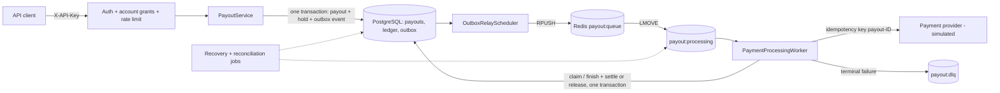
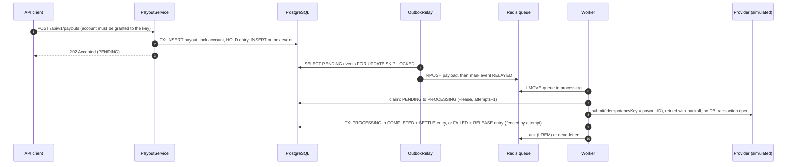

# Outbox Payment System

A Spring Boot service that simulates payout processing with the **transactional outbox pattern**.
PostgreSQL is the source of truth for payouts, outbox events and the **ledger** (balances and an
append-only journal). Redis carries the work queue, rate limits and scheduler locks. Background jobs
relay events, process payments through a simulated payment provider, and repair anything left
unfinished by crashes.

> **Simulation only.** The payment provider is a simulator. No real money moves and no external
> financial service is called.

## Contents

- [Architecture](#architecture)
- [Payout lifecycle](#payout-lifecycle)
- [Ledger](#ledger)
- [Reliability design](#reliability-design)
- [Technology stack](#technology-stack)
- [Getting started](#getting-started)
- [Upgrading from the Redis ledger (V3 → V4)](#upgrading-from-the-redis-ledger-v3--v4)
- [Configuration](#configuration)
- [API](#api)
- [Testing](#testing)
- [Queue recovery and dead-letter behaviour](#queue-recovery-and-dead-letter-behaviour)
- [Security](#security)
- [Performance](#performance)
- [Known limitations](#known-limitations)
- [Roadmap](#roadmap)

## Architecture



| Package | Responsibility |
| --- | --- |
| `controller/` | Payout API (account-scoped), admin ledger/DLQ/reconciliation, dev-only seeding |
| `service/` | Payouts, PostgreSQL ledger, reconciliation, legacy Redis import, provider calls, recovery |
| `service/gateway/` | Payment-provider contract and the idempotent simulator |
| `queue/` | Reliable Redis list queue (claim, ack, dead-letter, requeue) |
| `security/` | API-key authentication, principals and account grants, Redis rate limiter |
| `scheduler/`, `worker/` | Outbox relay, recovery and reconciliation jobs, queue consumer |
| `config/`, `domain/`, `dto/`, `repository/`, `exception/`, `metrics/` | Configuration, model, persistence, errors, metrics |

## Payout lifecycle



| Status | Meaning |
| --- | --- |
| `PENDING` | Funds held, outbox event written, waiting for a worker |
| `PROCESSING` | Claimed by a worker holding a lease |
| `COMPLETED` | Provider paid; the hold is settled (can never be refunded) |
| `FAILED` | Declined, retries exhausted, or delivery budget spent; the hold is released exactly once |
| `REJECTED` | Insufficient balance or unknown account; nothing held |
| `CANCELLED` | Legacy only: a request abandoned mid-way under the old Redis ledger |
| `RESERVING` | Legacy only: no longer produced |

`fundsStatus` is `HELD`, `SETTLED`, `RELEASED` or `NONE`; `RELEASE_PENDING` appears only for refunds
owed by imported legacy payouts and is completed by the recovery job.

## Ledger

Balances live in PostgreSQL:

- `ledger_accounts(account_id, available_balance, held_balance)`, with `CHECK (... >= 0)` on both, so the database refuses an overdraft.
- `ledger_entries` is an append-only journal. Each row records `available_delta`, `held_delta`, the resulting balances and a unique `idempotency_key`. Entry types are `OPENING_BALANCE`, `ADJUSTMENT`, `HOLD`, `RELEASE` and `SETTLE`.
- Partial unique indexes allow **one `HOLD` per payout** and **one terminal entry (`RELEASE` *or* `SETTLE`) per payout**. A completed payout cannot be refunded, even by a bug.

| Operation | available | held | When |
| --- | --- | --- | --- |
| HOLD | −amount | +amount | Payout accepted (same transaction as the payout and outbox rows) |
| SETTLE | 0 | −amount | Payout completed (same transaction as the status change) |
| RELEASE | +amount | −amount | Payout failed (same transaction as the status change) |
| ADJUSTMENT | ±delta | 0 | Dev seeding |
| OPENING_BALANCE | +balance | 0 | Legacy Redis import |

Every mutation locks the account row (`SELECT … FOR UPDATE`), so concurrent changes to one account are
serialised. Lock order is always payout row, then account row, so the two can't deadlock.

**Reconciliation** (`LedgerReconciliationService`, scheduled every 5 minutes and available at
`GET /api/v1/payouts/ledger/reconciliation`) verifies three things:
1. Each account's balances equal the sum of its entries.
2. Each account's held balance equals its open holds.
3. Each payout's funds status matches its entries.

Findings are logged at ERROR and exported as the `ledger.reconciliation.mismatches` gauge.

**Why the move from Redis.** Under the old design, holding funds (Redis) and recording the payout
(PostgreSQL) could not share a transaction, which required a reservation saga, compensations and
reconciliation retries, and made Redis data loss a money risk. With the ledger in PostgreSQL every
money movement commits atomically with the payout state change that causes it.

## Reliability design

- **Atomic money movement.** Creating a payout (row, hold, outbox event) is one transaction. Finishing a payout (status, settle or release) is one transaction. Ledger operations require an enclosing transaction (`Propagation.MANDATORY`).
- **Duplicate and concurrent processing.** Workers claim payouts with a conditional `UPDATE` plus a lease. Outcomes are written only by the current claim holder, using the attempt number as a fencing token. Holds, releases and settlements are idempotent per payout and enforced by unique indexes.
- **Provider idempotency.** Every provider call for a payout uses the idempotency key `payout-<payoutId>`, including backoff retries, redeliveries after a crash and other workers. A provider must return the original result for a repeated key; the simulator does, and also refuses a concurrent request with the same key. After the last timeout the worker **looks up** the key before giving up:
  - If the provider has a result, that result stands.
  - If a request with that key is still in flight, the payout is left unresolved (neither failed nor refunded) and retried later.
  - Only if the provider has no record is the payout failed and refunded.
- **Idempotent API.** Idempotency keys are unique per API client. Identical retries return the original payout. A different payload with the same key returns `409`. Concurrent duplicates are resolved by the unique constraint.
- **Delivery semantics.** Outbox to queue is at-least-once, and the queue redelivers abandoned messages. Exactly-once *effects* come from the database claim/fencing, the ledger constraints and provider idempotency, not from Redis.

## Technology stack

Java 21 · Spring Boot 3.5 (Web, Validation, Security, Data JPA, JDBC, Data Redis, Actuator) · Spring
Retry · ShedLock (Redis provider) · Flyway · PostgreSQL 16 · Redis 7 · Micrometer · JUnit 5, Mockito,
Testcontainers · Docker · GitHub Actions.

## Getting started

### Prerequisites

- Java 21
- Docker Desktop (or Docker Engine with Compose v2)
- Maven 3.9+ is optional; the Maven Wrapper (`mvnw` / `mvnw.cmd`) is included

### 1. Configure environment variables

```bash
cp .env.example .env        # Windows PowerShell: Copy-Item .env.example .env
```

Edit `.env` and replace every placeholder. In particular:

- `APP_CLIENT_API_KEY` and `APP_ADMIN_API_KEY`: at least 32 random characters each. Generate them with `openssl rand -hex 32`, or in PowerShell: `$b = New-Object byte[] 32; [Security.Cryptography.RandomNumberGenerator]::Create().GetBytes($b); -join ($b | ForEach-Object { $_.ToString('x2') })`. You may set `*_API_KEY_SHA256` (the key's hex SHA-256) instead, so the server never holds the plain key.
- `APP_CLIENT_ACCOUNTS`: the comma-separated ledger accounts the client key may use, e.g. `user_123`.

The application refuses to start if a key is missing, short, a placeholder or reused.

> If you previously ran this project with the original `docker-compose.yml`, the existing PostgreSQL
> volume was initialised with the password `payment_pass`. Either set `POSTGRES_PASSWORD=payment_pass`
> in `.env` or recreate the volume (`docker compose down -v`, which deletes local data).

### 2. Start PostgreSQL and Redis

```bash
docker compose up -d
```

Both bind to `127.0.0.1` only. If ports 5432/6379 are taken, set `POSTGRES_HOST_PORT`,
`REDIS_HOST_PORT`, `DB_URL` and `REDIS_PORT` in `.env`.

### 3. Run the application

```bash
./mvnw spring-boot:run -Dspring-boot.run.profiles=dev      # macOS/Linux
mvnw.cmd spring-boot:run "-Dspring-boot.run.profiles=dev"  # Windows
```

The application reads `.env` from the working directory. The `dev` profile enables ledger seeding
and the `loggers` actuator endpoint; omit it everywhere else. To run everything in containers:
`docker compose --profile app up -d --build`.

### 4. Try it

```bash
ADMIN=<APP_ADMIN_API_KEY>; CLIENT=<APP_CLIENT_API_KEY>
curl -X POST "http://localhost:8080/api/v1/payouts/ledger/seed?accountId=user_123&amount=100000" -H "X-API-Key: $ADMIN"
curl -X POST http://localhost:8080/api/v1/payouts -H "X-API-Key: $CLIENT" -H "Content-Type: application/json" \
     -d '{"recipientId":"user_123","amount":5000,"currency":"INR","idempotencyKey":"payout-req-001"}'
curl http://localhost:8080/api/v1/payouts/<id> -H "X-API-Key: $CLIENT"
```

### Database migrations

Flyway runs automatically at startup (`src/main/resources/db/migration`):

| Version | Change |
| --- | --- |
| V1 | `payouts` table |
| V2 | `outbox_events` table |
| V3 | `TIMESTAMPTZ` timestamps (existing values interpreted as Asia/Kolkata), `funds_status`, `lease_until`, `failure_reason`, check constraints, indexes |
| V4 | `ledger_accounts` and `ledger_entries` (with non-negative balance checks and per-payout unique hold/terminal indexes); `payouts.client_id` and `payouts.provider_reference`; the global idempotency-key uniqueness is replaced by uniqueness per `(client_id, idempotency_key)` |

`spring.jpa.hibernate.ddl-auto=validate` makes startup fail if entities and schema drift apart.

## Upgrading from the Redis ledger (V3 → V4)

V4 deletes no data. It is **not** compatible with running old and new versions side by side.

1. **Stop every old instance.** They write balances to Redis and rely on the old global idempotency constraint, so a rolling upgrade is unsafe.
2. **Back up PostgreSQL and Redis** (`pg_dump`, plus the Redis AOF/RDB files).
3. **Start the new version.** Flyway applies V4. Then `RedisLedgerImporter` runs before the HTTP server and scheduled jobs start. For every legacy account, it:
   - creates the PostgreSQL account with an `OPENING_BALANCE` equal to the Redis balance plus the funds still held for in-flight payouts;
   - adds one `HOLD` entry per such payout;
   - normalises each payout's funds status. Hold markers decide whether a `RELEASE_PENDING` or abandoned `RESERVING` payout is still owed its refund.

   Imported Redis keys are **renamed** to `ledger-migrated:<accountId>`, not deleted; hold markers are left untouched. The import is idempotent and safe if several instances start at once. An account that already exists in PostgreSQL is never overwritten; it is reported as a conflict for manual review.
4. **Verify.** `GET /api/v1/payouts/ledger/reconciliation` must report `consistent: true`. Owed refunds complete within one recovery cycle (30 s).
5. **Afterwards**, keep or archive the `ledger-migrated:*` and `ledger:hold:*` keys, and optionally set `LEDGER_REDIS_IMPORT_ENABLED=false`.

Also note:
- Existing payouts are attributed to the client `legacy`, a reserved name. Payouts are readable by any key granted their account.
- Responses gain `providerReference`.
- All payout calls now need an API key granted the account.

**Rollback** after new payouts exist requires copying balances back to Redis. Prefer restoring the backups.

The upgrade was rehearsed end to end:
1. The previous version took 800 payouts and was hard-killed mid-processing, leaving 615 payouts in flight and 61,500 held.
2. The new version imported the account (available 924,600, held 61,500), finished every payout, and reconciled exactly.
3. The final balance equalled the seed minus every completed payout across both versions.

## Configuration

Environment variables (see `.env.example`):

| Variable | Purpose | Default |
| --- | --- | --- |
| `DB_URL`, `DB_USERNAME`, `DB_PASSWORD`, `DB_POOL_SIZE` | Database connection | `localhost:5432/payment_db`, `payment_user`, required, `20` |
| `REDIS_HOST`, `REDIS_PORT`, `REDIS_PASSWORD` | Redis connection | `localhost`, `6379`, none |
| `APP_CLIENT_NAME`, `APP_CLIENT_API_KEY` or `APP_CLIENT_API_KEY_SHA256`, `APP_CLIENT_ACCOUNTS` | The API client and its granted accounts | `default-client`, required, none |
| `APP_ADMIN_API_KEY` or `APP_ADMIN_API_KEY_SHA256`, `APP_ADMIN_ACCOUNTS`, `APP_ADMIN_READ_ALL_PAYOUTS` | Admin key, optional payout grants, explicit read-all opt-in | required, none, `false` |
| `LEDGER_REDIS_IMPORT_ENABLED` | Legacy Redis ledger import at startup | `true` |
| `POSTGRES_HOST_PORT`, `REDIS_HOST_PORT`, `APP_HOST_PORT` | Host ports for docker compose | `5432`, `6379`, `8080` |

**Several API clients.** Environment variables configure one client. For more, put the whole list in
an extra config file and point `SPRING_CONFIG_ADDITIONAL_LOCATION` at it. Spring replaces lists
rather than merging them across sources.

```yaml
payout:
  security:
    clients:
      - name: merchant-a
        api-key-sha256: 3f1c…          # hex SHA-256 of the key
        accounts: [merchant_a_main, merchant_a_eu]
      - name: merchant-b
        api-key-sha256: 9ab0…
        accounts: [merchant_b_main]
```

Application settings (`application.yaml`, prefix `payout.`):

| Property | Default | Meaning |
| --- | --- | --- |
| `supported-currencies` | `INR` | Accepted ISO 4217 codes (the ledger has no currency dimension) |
| `rate-limit.enabled` / `fail-open` | `true` / `true` | Rate limiting; behaviour when Redis is unreachable (`false` → 503) |
| `rate-limit.create` | 50 burst, 20/s | `POST /api/v1/payouts` per client |
| `rate-limit.read` | 200 burst, 100/s | Payout reads per client |
| `rate-limit.admin` | 30 burst, 10/s | Ledger/DLQ/protected actuator per key |
| `rate-limit.auth-failure` | 20 burst, 1/s | Invalid API keys per client IP |
| `relay.interval-ms` / `batch-size` / `lock-at-most-for` | `1000` / `100` / `PT1M` | Outbox relay |
| `worker.poll-interval-ms` / `concurrency` / `batch-size` | `200` / `16` / `20` | Queue consumer |
| `worker.lease-duration` / `max-delivery-attempts` | `PT60S` / `5` | Claim lease and delivery budget |
| `queue.visibility-timeout` | `PT2M` | Age after which an in-flight message is re-queued (must exceed the lease) |
| `recovery.interval-ms` / `reconciliation-interval-ms` / `stuck-payout-timeout` | `30000` / `300000` / `PT10M` | Recovery and reconciliation jobs |
| `gateway.success-percent` / `failure-percent` / `processed-before-timeout-percent` | `70` / `20` / `50` | Simulator outcome mix (remaining 10 % time out; half of those after paying) |
| `gateway.max-attempts` / `backoff-delay-ms` / `backoff-multiplier` | `3` / `2000` / `2` | Provider retry policy |
| `ledger.seed-enabled` | `false` | Enables the seeding endpoint (`true` in `dev`) |

## API

All endpoints except `/actuator/health` and `/actuator/info` require an `X-API-Key` header. The full
specification is in [`docs/openapi.yaml`](docs/openapi.yaml).

| Method | Path | Who | Description |
| --- | --- | --- | --- |
| `POST` | `/api/v1/payouts` | Key granted the `recipientId` account | Initiate a payout. `202 Accepted` |
| `GET` | `/api/v1/payouts/{id}` | Key granted the payout's account (ADMIN only with read-all) | Fetch a payout |
| `POST` | `/api/v1/payouts/ledger/seed?accountId=&amount=` | ADMIN, `dev` only | Set an account's available balance |
| `GET` | `/api/v1/payouts/ledger/balance/{accountId}` | ADMIN | Available balance |
| `GET` | `/api/v1/payouts/ledger/accounts/{accountId}` | ADMIN | Available and held balance, last 50 ledger entries |
| `GET` | `/api/v1/payouts/ledger/reconciliation` | ADMIN | Ledger consistency report |
| `GET` | `/api/v1/payouts/dlq` | ADMIN | Dead-lettered messages |
| `GET` | `/actuator/health`, `/actuator/info` | public | Health (component details for ADMIN), build info |
| `GET` | `/actuator/metrics/**` | ADMIN | Metrics |

Request:

```json
{ "recipientId": "user_123", "amount": 5000, "currency": "INR", "idempotencyKey": "payout-req-001" }
```

Validation:
- `recipientId`: 1–64 characters from `[A-Za-z0-9_-]`.
- `amount`: integer from 1 to 1,000,000,000,000.
- `currency`: 3 uppercase letters, and one of `supported-currencies`.
- `idempotencyKey`: 8–128 characters from `[A-Za-z0-9._:-]`, unique per API client.

Response (`202`), with timestamps as UTC instants:

```json
{
  "id": "f2f6a4d7-8d7a-4d62-8d1f-3b2b7b0a1a7c",
  "recipientId": "user_123",
  "amount": 5000,
  "currency": "INR",
  "status": "PENDING",
  "fundsStatus": "HELD",
  "failureReason": null,
  "providerReference": null,
  "createdAt": "2026-07-04T04:30:00.123456Z",
  "updatedAt": "2026-07-04T04:30:00.131002Z",
  "attempts": 0
}
```

Errors are RFC 7807 problem details:

| Status | When |
| --- | --- |
| `400` | Validation failure (with an `errors` map), malformed JSON/UUID/parameter, unsupported currency |
| `401` | Missing or invalid API key |
| `403` | Role not allowed (`forbidden`), or the key is not granted the account (`account-access-denied`) |
| `404` | Unknown route or account, or a payout that doesn't exist **or belongs to an account the key isn't granted** (existence isn't revealed) |
| `405` | Unsupported HTTP method |
| `409` | `idempotency-key-reused` (same key, different payload) |
| `422` | Insufficient balance or unknown recipient account (replays of the same key return 422 again) |
| `429` | `rate-limited`, with `Retry-After` |
| `503` | `rate-limiter-unavailable` (only when `rate-limit.fail-open=false`) |
| `500` | Unexpected error (no internal details are returned) |

## Testing

```bash
./mvnw verify          # macOS/Linux
mvnw.cmd verify        # Windows
```

Docker must be running: integration tests start PostgreSQL 16 and Redis 7 with Testcontainers.
Background scheduling is disabled in the `test` profile, so tests drive the jobs explicitly. The
provider outcome source is a Mockito stub, an injectable clock simulates timeouts, and state is reset
before and after every test.

| Test class | Covers |
| --- | --- |
| `OutboxApplicationTests` | Context start, all four migrations, Redis/PostgreSQL wired to the containers |
| `SchedulingIntegrationTest` | All four jobs registered; a payout processed end to end by the real schedulers |
| `SecurityConfigTest` | Key validation (length, placeholders, duplicates, reserved names, SHA-256 keys), explicit account grants |
| `PayoutApiSecurityIntegrationTest` | 401/403, cross-account create (403) and read (404), shared accounts, per-client idempotency, admin not bypassing ownership, actuator exposure |
| `RateLimitIntegrationTest` | Per-client create limit with refill, separate read bucket, admin limit, invalid-key throttling per IP, fail-open and fail-closed |
| `PayoutApiErrorHandlingIntegrationTest` | 400/404/405/409/422/500 responses without internal details |
| `LedgerServiceIntegrationTest` | Idempotent hold, refund exactly once, settle/release exclusivity (including the DB constraint), 25 concurrent holds never overdraw, 10 concurrent releases refund once, mixed concurrent operations reconcile, tamper detection |
| `PayoutServiceIntegrationTest` | Atomic creation, idempotent replay, key reuse conflict, per-client keys, insufficient balance, concurrent same-key requests, DB failure rolls back payout + hold + outbox together |
| `OutboxRelaySchedulerIntegrationTest` | Publishing, no double publish, retry after Redis failure, bounded batches |
| `PaymentProcessingWorkerIntegrationTest` | Success, failure with exactly-once refund, duplicate after completion, concurrent delivery, crash recovery, DLQ, delivery budget, malformed messages |
| `GatewayIdempotencyIntegrationTest` | Same key on every retry, lost response not paid twice, crash redelivery not paid twice, duplicate submits, in-flight request neither failed nor refunded |
| `PayoutRecoveryServiceIntegrationTest` | Owed refunds completed once, lost messages re-published |
| `RedisLedgerImporterIntegrationTest` | Legacy import of every funds state, no money lost, idempotent re-run, conflicts not overwritten, crash before rename |

CI (`.github/workflows/ci.yml`) runs `./mvnw verify` and builds the Docker image on every push to
`main` and every pull request. It needs no repository secrets.

## Queue recovery and dead-letter behaviour

| Redis key | Purpose |
| --- | --- |
| `payout:queue` | Messages waiting for a worker |
| `payout:processing` / `payout:processing:claims` | Claimed messages and their claim timestamps |
| `payout:dlq` / `payout:dlq:ids` | Dead-lettered payloads, de-duplicated by payout ID |
| `ratelimit:*` | Token buckets |
| `gateway:sim:payment:*` | The simulator's idempotency store (stands in for the provider's storage) |
| `ledger-migrated:*`, `ledger:hold:*` | Preserved legacy Redis ledger data (read-only after import) |

The recovery job runs every 30 s on one instance at a time (ShedLock). Each run:
1. Re-queues messages abandoned in `payout:processing`.
2. Completes owed refunds.
3. Re-publishes payouts that have been idle too long and whose message was lost.

Reconciliation runs every 5 minutes.

A message is dead-lettered, and its payout `FAILED` and refunded, when:
- the provider has no record of the payout after all retries (`RETRIES_EXHAUSTED`);
- the payout has been claimed `max-delivery-attempts` times (`MAX_DELIVERY_ATTEMPTS`);
- the message is malformed or references an unknown payout.

## Security

- **Authentication:** API keys in the `X-API-Key` header, compared as SHA-256 digests in constant time. Keys can be configured as digests. The service is stateless: no sessions, no cookies, CSRF off.
- **Authorization by account:** each CLIENT key has an explicit list of granted ledger accounts. It can only create payouts for, and read payouts of, those accounts. Payouts on other accounts return 404.
- **ADMIN is an operations role:**
  - It can use ledger, DLQ, reconciliation and protected actuator endpoints, and see balances of any account (documented, for support).
  - It can create payouts only for accounts in `APP_ADMIN_ACCOUNTS` (none by default).
  - It can read other payouts only with `APP_ADMIN_READ_ALL_PAYOUTS=true` (off by default).
- **Rate limiting:** distributed token buckets in Redis for payout creation, reads and admin endpoints (per key), and invalid keys (per client IP). The limiter fails open by default; set `payout.rate-limit.fail-open=false` to refuse requests when Redis is down.
- **Secrets** come only from environment variables or a git-ignored `.env`; the repository contains test-only keys. Ledger seeding exists only when `payout.ledger.seed-enabled=true` (the `dev` profile).
- **Actuator:** only `health`, `info` and `metrics` are exposed (`loggers` only in `dev`). Health details are shown to ADMIN only.
- **Errors and logs:** errors never include stack traces or internal messages. Logs never contain API keys or queue payloads; invalid-key attempts log the client address only. Spring Security's default headers (`X-Content-Type-Options`, `X-Frame-Options`, no-store `Cache-Control`) are sent.
- **Containers:**
  - The app container runs as non-root `uid 10001` with a read-only root filesystem, all capabilities dropped and `no-new-privileges`.
  - Redis requires a password, fsyncs every write and never evicts. `FLUSHALL`, `FLUSHDB`, `DEBUG` and `KEYS` are disabled.
  - All ports bind to `127.0.0.1`.

**Behind a reverse proxy**, the per-IP limiter sees the proxy's address. Set
`server.forward-headers-strategy=native` only when the proxy is trusted and overwrites
`X-Forwarded-For`. TLS must be terminated in front of the service.

## Performance

[`loadtest/benchmark.py`](loadtest/benchmark.py) (standard-library Python) seeds an account the client
key is granted, submits N payouts with C concurrent clients, retries `429` responses after
`Retry-After`, waits until every payout is terminal, and checks that the final balance equals the seed
minus all completed amounts.

```bash
python loadtest/benchmark.py --base-url http://localhost:8080 --client-key <CLIENT_KEY> \
  --admin-key <ADMIN_KEY> --account bench_account --payouts 2000 --concurrency 50
```

Raise `payout.rate-limit.create` when measuring throughput; otherwise you measure the limiter.

> **These numbers predate V4.** They were measured on 2026-10-09 against the previous version
> (Redis ledger, no rate limiting), and have not been re-measured since the ledger moved to PostgreSQL.

Setup: AMD Ryzen 5 5600H (12 threads), 15 GB RAM, Windows 11, Docker Desktop, default settings.

| Metric | Result |
| --- | --- |
| Payouts submitted / accepted | 2,000 / 2,000 (0 errors) |
| API throughput (50 clients) | 173 req/s |
| API latency | avg 286 ms · p50 209 ms · p95 735 ms · p99 1,388 ms |
| End-to-end throughput | 31.2 payouts/s |
| Ledger check | OK |

## Known limitations

- **Single-currency ledger.** The ledger has no currency dimension, so only configured currencies are accepted.
- **The recipient account is debited.** This is the original model. A real payout would debit a source account and credit the recipient.
- **The provider is simulated.** A real integration must implement `PaymentProvider` with the provider's idempotency key and a status lookup. Even then, a payout whose provider request never resolves will, after `max-delivery-attempts`, be failed and refunded. A real deployment should route such payouts to manual review instead.
- **Reconciliation detects but doesn't repair.** Mismatches need human review.
- **Account grants are static configuration.** There's no self-service key management or rotation tooling. Changing grants requires a restart.
- **Hot accounts serialise on their row lock.** That's correct, but it limits throughput for a single very busy account.
- **`PayoutQueue.isInFlight` uses `LPOS`,** which is O(queue length). The stuck-payout sweep is bounded, but very large backlogs would need an index structure.
- **Log timestamps are UTC.** The JVM default time zone is forced to UTC so the PostgreSQL driver never sends legacy zone IDs such as `Asia/Calcutta`.

## Roadmap

- Manual-review state for payouts whose provider outcome stays unknown
- Key management: rotation, expiry and per-key audit log
- Double-entry ledger with explicit source and destination accounts and multi-currency balances
- Redis Streams consumer groups instead of list-based queue recovery
- DLQ re-drive endpoint with audit trail
- Prometheus registry and dashboards; alert on `ledger.reconciliation.mismatches > 0`
- Re-run and publish benchmarks for the PostgreSQL ledger; k6 scenarios in CI

## License

No license has been specified for this repository.
