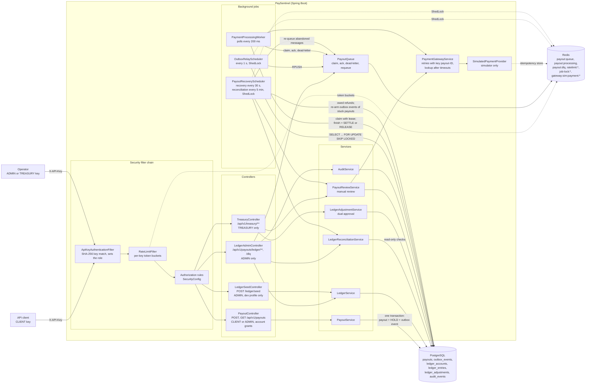
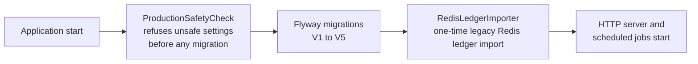

# PaySentinel architecture

This page shows how the running application is put together: the security filter chain, the
controllers and services, the background jobs, and what each component stores in PostgreSQL and Redis.
The payment provider is a **simulator** (`SimulatedPaymentProvider`): no real money moves and no bank
or payment network is called.

## Components

## Startup order

## How the parts fit together

| Component | Responsibility | Source |
| --- | --- | --- |
| Security filter chain | Authenticates `X-API-Key` by SHA-256 digest (401 for an unknown key), applies per-key rate limits, then enforces role rules: `/api/v1/payouts/ledger/**` and `/api/v1/payouts/dlq` need ADMIN, `/api/v1/treasury/**` needs TREASURY, `/api/v1/payouts/**` needs CLIENT or ADMIN | `security/ApiKeyAuthenticationFilter`, `security/RateLimitFilter`, `config/SecurityConfig` |
| `PayoutController` | Creates payouts only for accounts granted to the key (403 `account-access-denied` otherwise); reads return 404 for payouts on accounts the key is not granted | `controller/PayoutController` |
| `PayoutService` | Writes the payout, the ledger `HOLD` and the outbox event in one PostgreSQL transaction; handles idempotency keys per client | `service/PayoutService` |
| `OutboxRelayScheduler` | Publishes pending outbox events to `payout:queue` and marks them relayed (at-least-once) | `scheduler/OutboxRelayScheduler` |
| `PaymentProcessingWorker` | Claims messages (`LMOVE` to `payout:processing`), claims the payout with a lease and fencing token, calls the provider, and records the outcome with its `SETTLE` or `RELEASE` entry in one transaction | `worker/PaymentProcessingWorker` |
| `PaymentGatewayService` | Retries timeouts with the same idempotency key; after the last timeout it looks the key up; unknown outcomes are never refunded | `service/PaymentGatewayService` |
| `PayoutRecoveryScheduler` | Re-queues abandoned messages, completes owed refunds, re-checks `MANUAL_REVIEW` payouts with the provider, re-publishes stuck payouts (their outbox event is set back to pending for the relay), and runs reconciliation | `scheduler/PayoutRecoveryScheduler`, `service/PayoutRecoveryService` |
| `LedgerReconciliationService` | Read-only consistency report: balances against journal entries, held funds against open holds, payout funds status against ledger entries | `service/LedgerReconciliationService` |
| `TreasuryController` | Dual-approval funding adjustments and manual-review resolutions, both audited | `controller/TreasuryController`, `service/LedgerAdjustmentService`, `service/PayoutReviewService` |

The payout lifecycle (sequence diagram), the ledger model and the dead-letter rules are described in
the [README](../README.md#payout-lifecycle).
